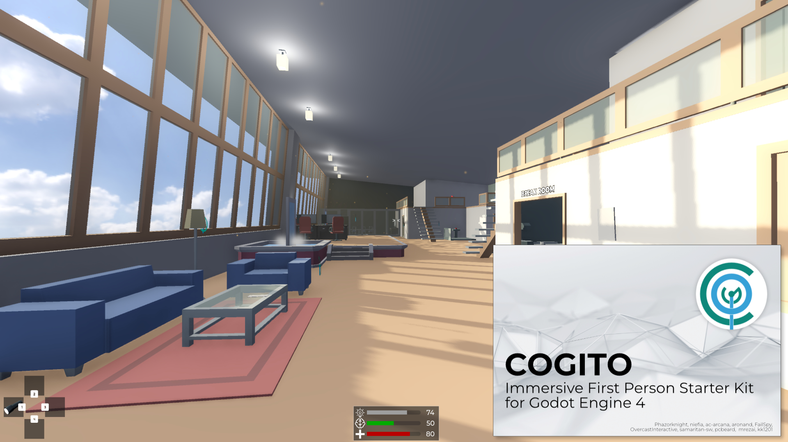

# Daedalion

> [!WARNING]
> **The git history of this repository has been rewritten. It is NOT the same history as Cogito on Codeberg.**
>
> Daedalion was created from [Cogito](https://codeberg.org/Phazorknight/Cogito) with
> `git filter-repo --invert-paths --path .tmp.driveupload --path .godot`, which removed
> about 1.5 GiB of accidentally committed upload and import-cache files (2023-2024) from
> **every** commit. The repository shrank from ~1.6 GiB to ~54 MiB.
>
> What this means for you:
>
> - **Every commit hash differs** from the matching Cogito commit, from the very first commit on.
>   The file contents of each upstream commit are unchanged apart from the removed paths.
> - You **cannot** merge or rebase between a Cogito clone and a Daedalion clone, and branches
>   cannot be pushed from one to the other. Clone this repository fresh instead of adding it as
>   a remote to an existing Cogito clone. Changes move between the two as patches
>   (see [Sending changes back to Cogito](#sending-changes-back-to-cogito)).
> - Tags (`v1.0` ... `1.2.0`) were rewritten too and point to the filtered commits.
> - Upstream changes are brought in with [`tools/sync_upstream.sh`](tools/sync_upstream.sh),
>   which runs the same filter on Cogito; the filter is deterministic, so the `upstream`
>   branch stays a linear continuation of the filtered Cogito history.

Daedalion is a fork of **COGITO**, the first person immersive sim template for Godot 4 by
[Philip Drobar](https://www.philipdrobar.com) and contributors. It started as current Cogito plus
changes proposed upstream but not merged there yet, and is now developed as its own project:
the goal is to move the template forward, not to stay mergeable with Cogito. Changes that fit
Cogito are still offered upstream where practical (see
[Sending changes back to Cogito](#sending-changes-back-to-cogito)), but that is optional.

[](https://codeberg.org/Phazorknight/Cogito) [](https://godotengine.org/)

`main` targets **Godot 4.7.2**: its resources and `.import` files are saved in the 4.7 format.
The `upstream`, `1.3.0-dev` and `pr/*` branches stay in Cogito's format (Godot 4.6), so that they
remain applicable to Cogito. Opening them in 4.7 rewrites ~260 `.import` files and a few resources;
do not commit those changes there (`git checkout -- .`).

## What is different from Cogito

- **1.3 refactor stack** (proposed in [issue #615](https://codeberg.org/Phazorknight/Cogito/issues/615),
  first part in [PR #634](https://codeberg.org/Phazorknight/Cogito/pulls/634)):
  PlayerInteractionComponent split into child nodes with an interaction contract and a public
  interaction API, `CogitoPlayer` base contract (`is CogitoPlayer` instead of the `Player` group),
  `CogitoHud` contract, saves by persistent id with in-place restoring, player node paths and setup,
  component actions, `CogitoPlayer.drop_item()`.
- **Quickslot sets** ([PR #631](https://codeberg.org/Phazorknight/Cogito/pulls/631)): generic slot sets,
  data-driven input and custom views (bar, radial wheel). In `main` it is adapted to the 1.3
  interaction split.
- **Spinner input** ([PR #632](https://codeberg.org/Phazorknight/Cogito/pulls/632)): the spinner follows
  the input instead of thresholded spin detection, with an on-screen input indicator.
- **Fixes** ([PR #633](https://codeberg.org/Phazorknight/Cogito/pulls/633)): elemental property states
  and an NPC alerted-state crash.
- **Elements**: elemental damage and states (burning, cold, poison...) for properties and actors,
  with demo stands and tests in `tests/elements/`.
- **Damage arguments**: burn damage passes the full `damage_received` arguments; buttons, switches
  and NPCs react to it correctly.
- **Demo decoupling**: the addon works without `DemoScenes`; the demo uses its own settings file
  (`cogito/settings/settings_file`).

## Branches

| Branch | Content |
| --- | --- |
| `main` | `upstream` + all branches below, merged |
| `upstream` | filtered mirror of Cogito `main`; never commit here |
| `1.3.0-dev` | the 1.3 refactor stack on top of `upstream` |
| `pr/quickslot-sets` | PR #631 as sent (on `upstream`, without the 1.3 split) |
| `pr/spinner-input` | PR #632 as sent |
| `pr/fixes-batch` | PR #633 as sent |
| `feat/elements` | elements system (on `1.3.0-dev`) |
| `pr/damage-args` | burn damage arguments, not sent yet |
| `pr/demo-decouple` | addon independent from the demo, not sent yet |

`pr/*` and `1.3.0-dev` branch off `upstream`, so each one is exactly the change set proposed to Cogito.
New features also go into their own branch off `upstream` first and are merged into `main` after that.

## Sending changes back to Cogito

Optional: done where a change fits Cogito and is practical to port. Because the hashes differ, branches are not pushed to Codeberg directly; the commits are carried
over as patches, which keeps authorship, dates and messages:

```sh
# in Daedalion
git format-patch upstream..pr/my-feature -o /tmp/my-feature
# in a regular Cogito clone, on top of Cogito main
git switch -c pr/my-feature origin/main
git am /tmp/my-feature/*.patch
```

Then open the pull request on Codeberg as usual.

## Keeping up with Cogito

```sh
tools/sync_upstream.sh          # updates the `upstream` branch from Codeberg
git switch main && git merge upstream
```

Requires `git` and `uv` (`uvx git-filter-repo`) or `git-filter-repo`. The first run mirrors
the full unfiltered Cogito history (~1.5 GiB) into `.git/cogito-upstream.git`; later runs only
fetch new commits. The script refuses to
update `upstream` if the filtered result does not continue the existing branch (for example
after a history rewrite on the Cogito side).

## Checks

Every push runs [`.github/workflows/checks.yml`](.github/workflows/checks.yml); locally the same
checks run with:

```sh
tools/check.sh                 # all: lint, warnings, tests, smoke
tools/check.sh tests           # only some steps: lint | warnings | tests | smoke
```

- **lint**: `gdlint` + `gdformat` (gdtoolkit 4.5.0, config in `gdlintrc`) via `tools/lint.py`.
  The code inherited from Cogito is not reformatted (that would conflict with every upstream
  merge); its existing problems are recorded in `tools/lint_baseline.json`, and the check fails
  only on problems a file did not have before. New files must be formatted
  (`tools/lint.py --format <file>`).
- **warnings**: Godot's own static warnings (unused variables, shadowing, unsafe calls...),
  collected from the editor's language server by `tools/gd_warnings.py`, with a baseline in
  `tools/gd_warnings_baseline.json`. `addons/cogito` is included in the warning checks
  (`debug/gdscript/warnings/directory_rules`), so the editor shows them too.
- **tests**: [gdUnit4](https://github.com/godot-gdunit-labs/gdUnit4) suites in `tests/`
  (also runnable from the editor's gdUnit panel).
- **smoke**: the demo scenes run for 400 frames headless without script errors.

After fixing old problems, lower the baselines with `tools/lint.py --update` and
`tools/gd_warnings.py --update`. Never update them to hide problems in new code.

## License and credits

MIT, same as Cogito; see [LICENSE](LICENSE). Cogito is © 2023 Phazorknight; see the
[Cogito credits, contributors and license](https://codeberg.org/Phazorknight/Cogito/wiki/Credits%2C-Contributors%2C-License).
Please report problems with changes that exist only in Daedalion here, not on the Cogito tracker.

---

## Original Cogito README


### COGITO
[](https://godotengine.org/) [](https://codeberg.org/Phazorknight/Cogito)

## What is it?
Cogito is a First Person Immersive Sim Template Project for Godot 4, providing a framework for creating interactable objects, various items to use and mechanics to influence the player and game environment.
In short, with COGITO you get a quick start for a fully-featured first person game with a great variety of mechanics and a solid base to create your own.

### [Online documentation + Tutorials](https://codeberg.org/Phazorknight/Cogito/wiki)
### [Cogito Community Space](https://community.thresholdanomaly.com/index.php?r=space%2Fspace&cguid=f29b9340-dc21-4a3c-8883-7e33bb804c27)
### [Cogito in the Godot Asset Store](https://store.godotengine.org/asset/philip-drobar/cogito/)

### Current Features
- State-based first person player controller:
  - Sprinting, jumping, crouching, sliding, stairs handling, ladder handling, sitting, swimming
  - Lots of exposed properties to tweak to your liking (speeds, headbob, fall damage, bunnyhop, etc.)
  - Easy-to-use dynamic footstep sound system
- Player Attribute System
  - Health, Stamina, Visibility for stealth, etc
  - Customize how attributes get displayed in the HUD (or stay hidden)
  - Also useable for RPG-like attributes (Strength, Wisdom, etc)
  - Interactions can check attributes (eg. you can only lift a box if you're strong enough)
- Interaction System
  - Component-based interactions makes it easy to turn your own objects interactive quickly and customize existing ones
  - Examples for interactive objects like doors, drawers, boxes to carry, turn-wheels, elevators, notes, keypads
- Inventory System
  - Flexible resource-based inventories
  - Grid-based (think Resident Evil 4)
  - Inventory UI separate from inventory logic
  - Examples for multiple item types (consumables, keys, ammo, weapons, combinable Items)
  - Base class to easily add your custom item types
  - Containers with their own inventories
- Cogito NPC
  - NavigationAgent based general purpose NPC with state machine + animation states
  - Player detection system based on line-of-sight + simulated hearing.
- Main menu, pause menu and Options menu
- Rebindable controls
- Basic Quest System
- Save and Load System as well as scene persistency
- Full game pad support!
- Localization!
- Support for other plugins:
  - Works with Dialogic
  - Works with Dialgue Manager
- Work in progress:
  - Systemic Properties (wet/dry, flammable/on fire, soft, etc) (very WIP)

### Comes with fully featured Demo Scenes
- Set up like a game level including a variety of objects, weapons and quests
- Demo scenes contains hints that explain how objects in the scene were set up

COGITO is made by [Philip Drobar](https://www.philipdrobar.com) with help from [these contributors](https://codeberg.org/Phazorknight/Cogito/wiki/Credits%2C-Contributors%2C-License).

## Principles of this template
The structure of this template always tries to adhere to the following principles:
- **Complete**: When you download COGITO and press play, you get a functioning project out of the box. Game menu, save slot select, options and a playable level are all included.
- **Versatile**: Whether your game is set in the future, the past or the present, use melee, projectile or no weapons at all, have low poly, stylized or realistic graphics, the template will have features for you.
- **Modular**: Do not want to use a feature? You will be able to hide it, ignore it or strip it out without breaking COGITO. At the same time, COGITO is designed to be extendable with your own custom features or other add-ons.
- **Approachable**: While there will always be a learning curve, we strive to make COGTIO approachable and intuitive to use, so it doesn't get in your way of making your game.
- **No Generative AI**: All included code and assets are made by humans and listed in our credits and cotnributors page.

> [!IMPORTANT]  
> COGITO v1.2 is not 100% bug-free. While most features are set, be aware that this open source software is offered "as is". Use at your own risk and check Issues and Discussion pages for more information.

[Credits, Contributors and License](https://codeberg.org/Phazorknight/Cogito/wiki/Credits%2C-Contributors%2C-License)
