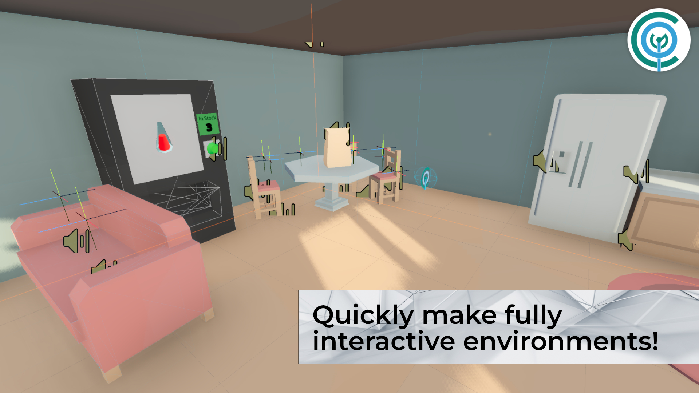

Based on the Cogito wiki page Home (https://codeberg.org/Phazorknight/Cogito/wiki/Home) by Philip Drobar and contributors, MIT.

# Daedalion documentation

Daedalion is a first-person immersive-sim template for Godot 4.7.2. It is an independent fork of [Cogito](https://codeberg.org/Phazorknight/Cogito) by Philip Drobar and contributors. The demo brings together a player controller, interactive objects, inventory, quests and persistent levels.

Documentation for Daedalion 1.3.1; docs for other versions: browse the docs/ folder at that git tag.

## Start or upgrade

- [Getting started](getting-started.md) — run the demo and create a playable level.
- [Migration from Cogito 1.2](migration-1.2-to-1.3.md) — update a project and transfer its saves.
- [1.3 changelog](changelog.md) — review breaking changes and included upstream work.

## Build a game

| Guide | Use it to |
| --- | --- |
| [Player controller](player-controller.md) | Configure movement, the HUD and a custom player. |
| [Level instances](levels.md) | Find and spawn game content in its own level and save an instance. |
| [Networking](networking.md) | Start a listen or dedicated server, join a session and inspect the roster. |
| [Input routing](input-routing.md) | Give a menu or spinner control of player input. |
| [Interactions](interactions.md) | Build an object with prompts and selectable actions. |
| [Quickslots](quickslots.md) | Add inventory slots or display a set in a bar or wheel. |
| [Attribute system](attribute-system.md) | Give a player or prop health, stamina or a custom value. |
| [NPCs](npc.md) | Set patrol routes and tune hearing, sight and behaviour. |
| [Elements](elements.md) | Combine fire, water, shock, cold and poison. |
| [Saves](saves.md) | Manage slots and edit levels that players have visited. |
| [Save format](save-format.md) | Inspect JSON files, resource references and legacy conversion. |

## Project reference

- [FAQ](faq.md) — troubleshoot setup, interaction and export issues.
- [Tutorial videos](tutorial-videos.md) — watch the original Cogito walkthroughs.
- [Testing](testing.md) — run the same checks as CI.
- [Roadmap](roadmap.md) — see the multiplayer and gamepad plans for 1.4.
- [Credits and license](credits.md) — find project, code and asset attributions.
