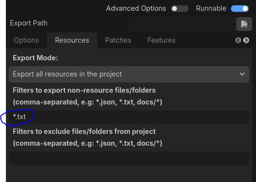

Based on the Cogito wiki page Frequently Asked Questions (https://codeberg.org/Phazorknight/Cogito/wiki/Frequently-Asked-Questions) by Philip Drobar and contributors, MIT.

# Frequently asked questions

### How much Godot experience do I need?

It helps to know how to instance a scene, inspect a node, connect a signal and edit a resource. Daedalion is a template. Play the Lobby and Laboratory to see which interactions suit your game, then [build a small level](getting-started.md) with those components.

### Why do I see a prompt but get no response?

Check that its action exists in the project's Input Map, has a binding, and matches the component's `input_map_action`. Check which screen owns input and whether a held object or open interface is blocking the action. See [Input routing](input-routing.md) and [Interactions](interactions.md).

### Why does my object have no prompt?

Give the collider a shape and make sure it is on a layer in the interaction ray's mask. The collider needs the `interactable` group and an interaction component in its `interaction_nodes` array. Try the supplied [BasicInteraction scene](../addons/cogito/Components/Interactions/BasicInteraction.tscn) as a child. For a carryable that moves erratically, check the rigid body's mass and collision geometry as well as the player's carry settings.

### How do I start in my own level or drop an item there?

Set `new_game_start_scene` on the settings selected by `cogito/settings/settings_file`. Attach the level root script and allow space in front of the player. A drop can fail if the drop shape already overlaps another collider. [Level setup](getting-started.md).

### How do I get the player?

Use `body is CogitoPlayer` when a trigger supplies a body. Otherwise use `CogitoSceneManager.get_player()` and check for null before accessing inventory or HUD.

### Where is weapon damage set?

Set `wieldable_damage` on the `WieldableItemPD` inventory resource. The wieldable uses it directly or passes damage to the projectile it spawns. Element exposure and damage from a continuous source have their own [element settings](elements.md).

### How do I add more quickslots?

Add a container to the HUD, bind its input action and register it on the bar. See the [fifth-slot walkthrough](quickslots.md).

### Why are credits missing from my exported game?

The credits scene reads [cogito_credit_list.txt](../addons/cogito/cogito_credit_list.txt). Under **Project > Export**, select the preset, open **Resources** and include `*.txt` in the non-resource file export filter.

### Escape leaves fullscreen in a browser build. Can I use another key?

Bind `menu` to another key in the Input Map, such as M. Test with a fresh configuration or update the saved binding in Options. Cogito user OneDev suggested using a separate menu key for embedded games.

### Where do I report a Daedalion issue?

Include the release, scene and steps needed to see the problem in the [Daedalion issue tracker](https://github.com/uxerror/Daedalion/issues).
