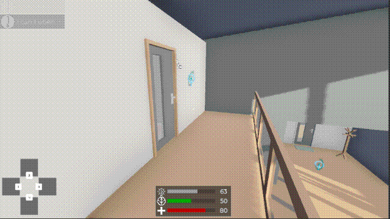

# Interactions

To make a sign the player can read, give its collider an interaction component. The collider is what the camera can hit. Its components describe what the player can do there.

1. Use a `CogitoStaticInteractable` for a stationary sign or a `CogitoObject` for a physics object. Give the body a collision shape on a layer the player's raycast can see and put the collider in the `interactable` group. The supplied object scripts collect child components in `interaction_nodes`.
2. Add a child with the script below. Set its `input_map_action` to `interact` and its `interaction_text` to the prompt, for example “Read sign”. Save the object and place an instance in the level.
3. Face the sign and press the action. The prompt names the action. The hint displays its result.

```gdscript
extends InteractionComponent

@export var message: String = "The archive is upstairs."

func interact(actor: PlayerInteractionComponent) -> void:
    actor.send_hint(null, message)
    was_interacted_with.emit(interaction_text, input_map_action)
```

## Actions and prompts

`InteractionComponent.get_actions()` already returns one `CogitoInteractionAction` for this sign. Its text comes from the prompt, its callable invokes `interact()` and its enabled flag reflects `is_disabled`. Override the method to offer several actions. Set each action's text, owning component, callable and availability. Compute availability without consuming an item, opening a screen or sending a hint. [DualInteraction](../addons/cogito/Components/Interactions/DualInteraction.gd) lists press and hold separately so a menu can select either directly.

Input uses `PlayerInteractionComponent.start_interaction()` with the action name and the current target. A context menu can list a target component's actions and pass the chosen one to `PlayerInteractionComponent.perform_action()`. Rebuild the list when the target or its availability changes. For example, a menu callback could run the sign's first available action like this.

```gdscript
func use_sign(component: InteractionComponent, actor: PlayerInteractionComponent) -> void:
    for action in component.get_actions(actor):
        if action.enabled:
            await actor.perform_action(action)
            return
```

While carrying, a direct action must belong to a component on the carried object's own parent body. With regular input, the matching carry action drops the object, and a pickup action can take it. Other world targets wait. Set `ignore_open_gui` to false to block the component while the player has an interface open. Set `disable_interaction_in_air` to require a grounded player. Direct actions check enabled state and these guards before running the callable.

## Player-side components

| Child node | Reference | Responsibility |
| --- | --- | --- |
| `InteractionTargeting` | `targeting` | Tracks the interactable, exposes reach and look direction, rebuilds prompts. |
| `CarryHandler` | `carrying` | Holds the carry component, moves, drops and throws the object. |
| `WieldableHandler` | `wieldables` | Equips wieldables and handles primary, secondary, ammo and reload input. |

Targeting signals `interactive_object_detected` with the target's components and `nothing_detected` when the target clears. Call `targeting.rebuild_interaction_prompts()` when a component changes its label. A carried object's drop prompt takes priority. For an interactable with its own screen, pair `open_interface()` and `close_interface()` with the same optional menu callback. Use `get_attribute()`, `get_inventory()`, `get_hud()` or `get_view_anchor()` for player services. See [input routing](input-routing.md) for a screen that takes over input.


