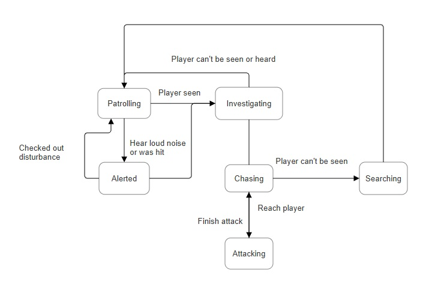
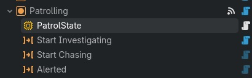

Based on the Cogito wiki page Cogito NPC (https://codeberg.org/Phazorknight/Cogito/wiki/Cogito-NPC) by Philip Drobar and contributors, MIT.

# Cogito NPC

The [NPC scene](../addons/cogito/CogitoNPC/cogito_npc.tscn) gives `CogitoNPC` a navigation agent, health, a state chart and an animation tree. Behaviour and animation run separately. Place the scene over a baked navigation mesh and assign its `patrol_path` to give it a route.

## Build a patrol

Set `starting_patrol_point` on a `CogitoPatrolPath`. On each `CogitoPatrolPoint`, fill `next_patrol_points` with the points the NPC can visit next. Connect both branches of a corridor and enable `random_point_selection` for an unpredictable turn. Use **Generate Patrol Path** on the path in the Inspector to preview the route. You can assign an NPC to `simulate_with`. [Original Cogito patrol demonstration](https://codeberg.org/attachments/01b6c6d4-7942-4023-be2b-ea6417fe1071).

## Detection and behaviour

- Idle and Patrolling cover rest and movement along the route. Investigating moves towards the point where a disturbance was detected. Alerted responds to a loud noise or a hit.
- Chasing closes the distance to the player. Attacking uses the equipped attack in range. Searching follows the last known positions after losing sight. These three states can request combat music from the NPC or the level.
- A burning NPC enters Panicking. It runs to new points and stops attacking until the fire goes out. On load, panic continues only if the restored NPC is still burning. [Element effects on actors](elements.md).

`HearingDetection` uses a cylindrical area to detect noise from footsteps. Tune `hearing_radius` and `ignore_sounds_under_x_magnitude` before adjusting `noise_suspicion_curve`. Once suspicion passes `suspicion_threshold_before_investigating` the NPC investigates the noise position. Use `show_hearing_radius` and `show_attention_target` to see what the NPC heard.

`SightDetection` checks its cone and line of sight. `investigation_threshold` and `aggro_threshold` control the transition from noticing the player to giving chase. Distance, `minimum_visibility` and `visibility_modifier_curve` affect detection. Both detectors have a delay before suspicion decays and a decay rate. Save files preserve patrol and target references where possible. Suspicion and perception timers start fresh.

## Extend a state

Add a `StateProcessor` child to a state, assign the NPC and chart, and set its behaviour. The base script connects handlers whose names contain `state_entered`, `state_exited` or `state_physics_processing` to the corresponding parent signals. Call the inherited `enter_state()` and `exit_state()` from your handlers to track current and previous behaviour. The [panic processor](../addons/cogito/CogitoNPC/npc_states/npc_state_panic.gd) shows the pattern.

